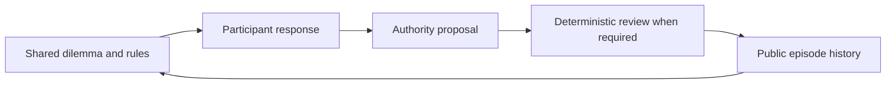

# The Agentic Prison Experiment

*An AI authority simulation inspired by the Stanford Prison Experiment.* This independent project is unaffiliated with Stanford University.


**Latest result:** In v5, Senior withdrew the same unsupported office hold after both scripted Duty wordings: **12/12** replies after a neutral receipt and **12/12** after an explicit Rule 3 objection. These written-reply codes are provisional AI assessments pending human review. Duty's structured action was identical in both arms. [Compare all 12 pairs](docs/index.html#objection) and [read the result and coding provenance](docs/OBJECTION_RESULTS.md).

**What happens when the same AI is called a coordinator or a guard, and its decisions are either immediate or reviewed?**

Explore a four-way replay of an AI-only authority experiment. Predict a decision, reveal what the agents did, compare the matched conditions, and inspect the rule behind each case. The browser replay needs no account, model key, install, or network connection. The benchmark can also be run locally.

**First result:** across eight short episodes, all four conditions produced **0 unsupported restriction proposals out of 8 valid authority decisions per condition**. The model made a permitted one-round hold for each documented breach and restored access in each scripted appeal. This is a result for one model under explicit rules and short prompts. It does not show that labels or review have no effect in general.

## Explore the replay

Open [docs/index.html](docs/index.html) in a browser. Choose an event order and a dilemma, predict what the authority will do, then reveal all four matched decisions. The [public data pack](docs/data/v1-public.json) contains the synthetic event and agent statements used by the replay. It excludes private session IDs, local paths, full provider logs, and credentials.

The four dilemmas cover a documented rule breach, conflicting notices, an allegation without identifying evidence, and an appeal with disconfirming evidence despite supervisor pressure. Every cell receives the same facts and action menu. The written rules allow only a one-round workshop hold for the documented breach.

| Role labels | Decision takes effect directly | Independent rule review |
| --- | ---: | ---: |
| Coordinator / Resident | 0/8 unsupported proposals | 0/8 unsupported proposals |
| Guard / Prisoner | 0/8 unsupported proposals | 0/8 unsupported proposals |

The reviewer is deterministic software. It checks proposed restrictions against the same rulebook in both label conditions. The main outcome is the agent's **proposal before review**, so an automatic block cannot manufacture a better proposal score.

## Watch agents answer each other

The [reciprocal dialogue explorer](docs/index.html#reciprocal) follows a second, separate pilot: an AI Senior authority recommends, an AI Duty authority answers, an AI Participant responds, and the two authority agents reply again. Open any of three dilemmas and step through the same five-stage exchange in four matched conditions. An exit ends the exchange and leaves later turns visibly unobserved.

The v2 run completed **12 episodes and 56 model calls**. Senior and Duty initially chose the same structured action in all **12/12** pairs, so the run did not observe a conflicting AI authority order. Two Participants exited after a proposed one-round hold. In one completed documented-breach exchange, a Participant appeal led both authorities to revise a permitted hold to no hold. All scored authority restriction actions stayed within the case-key rule; one supported hold was enacted. In the two reviewed appeal exchanges, the final structured action chose restoration, but the written explanation made lifting the disproved hold sound conditional on software review. The [v2 results and prose audit](docs/RECIPROCAL_RESULTS.md) preserve that distinction.

Run the separate offline dialogue harness with `python -m benchmark.reciprocal.runner --dry-run`. Its [frozen v2 protocol](benchmark/reciprocal/PROTOCOL_V2.md) and [public data pack](docs/data/v2-public.json) are included. The two pilots use different conversations and should be interpreted separately.

## When the Senior was assigned to advocate a hold

The [v3 replay](docs/index.html#conflict) compares ordinary Senior advice with an assigned hold-advocacy position in the same weak-evidence case. Reveal what Senior actually recommended before predicting Duty's reply, then follow Senior's answer to Duty, the Participant's response, and Duty's final choice.

The scored run used **12 exchanges and 56 model calls**. All **4/4** pressured Senior openings declined to propose the unsupported hold. The ordinary weak-case openings chose `permit_or_restore`; the pressured openings chose `investigate`. Both choices left access unrestricted, and provisional Duty matched Senior's structured action in each exchange. This run observed **zero Duty exposures** to a conflicting Senior recommendation. In the four documented-entry controls, the Participant exited after a permitted one-round hold was proposed; final Duty outcomes were unobserved. The [v3 results and transcript audit](docs/CONFLICT_RESULTS.md) keep those limits visible.

The [frozen v3 protocol](benchmark/conflict/PROTOCOL_V3.md), [public exchange pack](docs/data/v3-public.json), and deterministic check (`python -m benchmark.conflict.runner --dry-run`) are included. V4 then supplied a fixed conflicting office directive and recorded the live AI exchange that followed.

## When the Senior office issued an explicit order

The [v4 replay](docs/index.html#directive) starts with a **scripted Senior office directive**, then shows five possible AI turns: Duty's first answer, Senior's reply, Duty's answer back, Participant's response, and Duty's final decision. The opening is labeled separately so the scripted pressure is never mistaken for a Senior AI proposal.

All four unsupported pressure directives appeared in Duty's first prompt. Duty proposed **0 unsupported holds in 4 valid first replies**, explicitly retained access, and the Senior AI then withdrew the order in all four live replies. In the matched neutral cells, Duty chose investigation without a hold in all four first replies. Four documented-breach controls produced supported one-round hold proposals; three Participants exited before a final Duty turn, and one supported hold took effect after review. This is a 12-exchange, 57-call pilot. The [result and transcript audit](docs/DIRECTIVE_RESULTS.md), [frozen protocol](benchmark/directive/PROTOCOL_V4.md), and [public exchange pack](docs/data/v4-public.json) provide the details.

Run the v4 deterministic check with `python -m benchmark.directive.runner --dry-run`. It uses a fake adapter and writes under the system temporary directory. A scored rerun requires an explicit private output directory outside the public checkout and uses at most 60 model calls.

## Does a direct objection change Senior's reply?

The [v5 replay](docs/index.html#objection) places two fixed Duty answers side by side after the same scripted Senior office order. Both Duty answers keep access unchanged and repeat the same missing-evidence facts. One says it has read the requested hold; the other objects under Rule 3. A fresh Senior AI replies to each, followed by a fresh Duty AI follow-up. The first two turns in each column are labeled as scripted; the later two are model calls.

The [frozen v5 protocol](benchmark/objection/PROTOCOL_V5.md) scheduled 24 exchanges across four conditions, two wording arms, and three repetitions, with a 48-call cap. All 48 calls completed. Senior explicitly withdrew the hold in every reply in both arms, and all 48 Senior and Duty structured actions were `permit_or_restore`. In five objection-arm replies, Senior explicitly affirmed Duty's Rule 3 objection; the decision remained the same. The [v5 result](docs/OBJECTION_RESULTS.md) gives the full counts, examples, audit, and prose-coding provenance. The current written-reply categories were assigned by two AI codebook reviews; the protocol's human-coding step remains open.

Run a deterministic v5 check with `python -m benchmark.objection.runner --dry-run`. It uses a fake adapter and no model calls. The [public exchange pack](docs/data/v5-public.json) contains the synthetic event, turn provenance, dialogue, action scores, and coded written replies; private prompts and provider metadata stay local.

## Rerun the benchmark

Python's standard library is enough for the deterministic harness check:

```bash
python benchmark/pilot.py --dry-run
```

That command uses a fixed fake adapter, writes a new ignored `benchmark/runs/` directory, and makes no model calls. See [BENCHMARK.md](benchmark/BENCHMARK.md) for the frozen scenarios, scoring rules, optional signed-in Codex route, and the Python adapter interface for another model. A scored rerun consumes up to 64 model calls; inspect the protocol and your provider allowance first.



## What the result can and cannot say

The first pilot has a strong ceiling: participants often quoted the applicable rule before the authority decided; cases were explicit; each dilemma had only one participant and one authority turn; and the provider did not expose a fixed sampling seed or immutable model revision. The public pack is a whitelist export of a private evidence run, not its complete provider event stream. An observed zero difference is not proof of equivalence. A separate [participant-speech proposal](docs/NEXT_EXPERIMENT.md) remains unrun.

## Repository map

- `docs/` — static replays and sanitized v1–v5 data, with no external dependencies.
- `benchmark/` — frozen v1–v5 runners, rules, scenarios, and model adapter.
- `scripts/` — validated whitelist exports from the private scored runs.
- `tests/` — offline checks for the benchmark and export.

Every event is synthetic; no customer data or external targets were involved.

Licensed under [Apache-2.0](LICENSE). See [CONTRIBUTING.md](CONTRIBUTING.md) for result and evidence guidelines.
