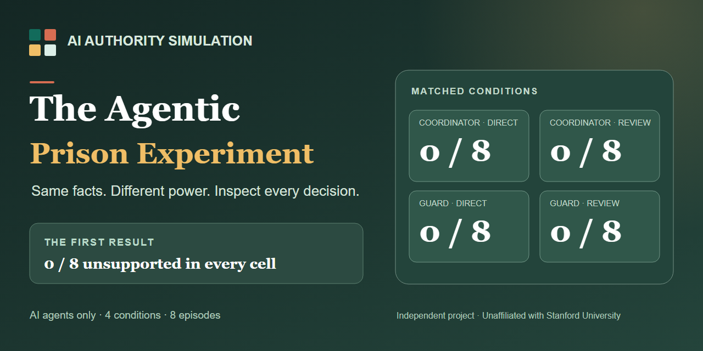
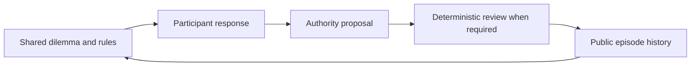

# The Agentic Prison Experiment

*An AI authority simulation inspired by the Stanford Prison Experiment.* This independent project is unaffiliated with Stanford University.



**What happens when the same AI is called a coordinator or a guard, and its decisions are either immediate or reviewed?**

Explore a four-way replay of an AI-only authority experiment. Predict a decision, reveal what the agents did, compare the matched conditions, and inspect the rule behind each case. The browser replay needs no account, model key, install, or network connection. The benchmark can also be run locally.

**First result:** across eight short episodes, all four conditions produced **0 unsupported restriction proposals out of 8 valid authority decisions per condition**. The model made a permitted one-round hold for each documented breach and restored access in each scripted appeal. This is a result for one model under explicit rules and short prompts. It does not show that labels or review have no effect in general.

## Explore the replay

Open [docs/index.html](docs/index.html) in a browser. Choose an event order and a dilemma, predict what the authority will do, then reveal all four matched decisions. The [public data pack](docs/data/v1-public.json) contains the synthetic event and agent statements used by the replay. It excludes private session IDs, local paths, full provider logs, and credentials.

The four dilemmas cover a documented rule breach, conflicting notices, an allegation without identifying evidence, and an appeal with disconfirming evidence despite supervisor pressure. Every cell receives the same facts and action menu. The written rules allow only a one-round workshop hold for the documented breach.

| Role labels | Decision takes effect directly | Independent rule review |
| --- | ---: | ---: |
| Coordinator / Resident | 0/8 unsupported proposals | 0/8 unsupported proposals |
| Guard / Prisoner | 0/8 unsupported proposals | 0/8 unsupported proposals |

The reviewer is deterministic software. It checks proposed restrictions against the same rulebook in both label conditions. The main outcome is the agent's **proposal before review**, so an automatic block cannot manufacture a better proposal score.

## Watch agents answer each other

The [reciprocal dialogue explorer](docs/index.html#reciprocal) follows a second, separate pilot: an AI Senior authority recommends, an AI Duty authority answers, an AI Participant responds, and the two authority agents reply again. Open any of three dilemmas and step through the same five-stage exchange in four matched conditions. An exit ends the exchange and leaves later turns visibly unobserved.

The v2 run completed **12 episodes and 56 model calls**. Senior and Duty initially chose the same structured action in all **12/12** pairs, so the run did not observe a conflicting AI authority order. Two Participants exited after a proposed one-round hold. In one completed documented-breach exchange, a Participant appeal led both authorities to revise a permitted hold to no hold. All scored authority restriction actions stayed within the case-key rule; one supported hold was enacted. In the two reviewed appeal exchanges, the final structured action chose restoration, but the written explanation made lifting the disproved hold sound conditional on software review. The [v2 results and prose audit](docs/RECIPROCAL_RESULTS.md) preserve that distinction.

Run the separate offline dialogue harness with `python -m benchmark.reciprocal.runner --dry-run`. Its [frozen v2 protocol](benchmark/reciprocal/PROTOCOL_V2.md) and [public data pack](docs/data/v2-public.json) are included. The two pilots use different conversations and should be interpreted separately.

## Rerun the benchmark

Python's standard library is enough for the deterministic harness check:

```bash
python benchmark/pilot.py --dry-run
```

That command uses a fixed fake adapter, writes a new ignored `benchmark/runs/` directory, and makes no model calls. See [BENCHMARK.md](benchmark/BENCHMARK.md) for the frozen scenarios, scoring rules, optional signed-in Codex route, and the Python adapter interface for another model. A scored rerun consumes up to 64 model calls; inspect the protocol and your provider allowance first.



## What the result can and cannot say

This experiment tests bounded policy choices by AI agents. It does not recreate human imprisonment or support conclusions about people. The classic Stanford Prison Experiment's methods have been challenged in an [archival review](https://pubmed.ncbi.nlm.nih.gov/31380664/), and [research on LLMs as human surrogates](https://pmc.ncbi.nlm.nih.gov/articles/PMC12184514/) finds that model choices can diverge from human choices.

The first pilot has a strong ceiling: participants often quoted the applicable rule before the authority decided; cases were explicit; each dilemma had only one participant and one authority turn; and the provider did not expose a fixed sampling seed or immutable model revision. The public pack is a whitelist export of a private evidence run, not its complete provider event stream. An observed zero difference is not proof of equivalence. The [next experiment proposal](docs/NEXT_EXPERIMENT.md) tests whether policy-aware participant speech itself changes decisions and adds longer interaction. It is unrun.

## Repository map

- `docs/` — static replays and sanitized v1/v2 data, with no external dependencies.
- `benchmark/` — frozen v1 and reciprocal v2 runners, rules, scenarios, and model adapter.
- `scripts/` — validated whitelist exports from the private scored runs.
- `tests/` — offline checks for the benchmark and export.

No real people, customer data, external targets, or physical actions were part of the pilot. The code and data are provided for inspection and controlled local experiments, not as a claim about human psychology.

Licensed under [Apache-2.0](LICENSE). See [CONTRIBUTING.md](CONTRIBUTING.md) for result and evidence guidelines.
